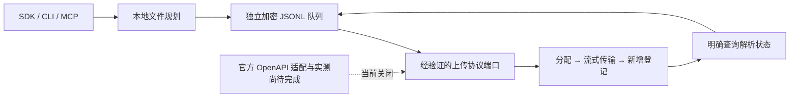

# 文件上传与批量入库：本地开发候选

本轮完成独立队列、SDK、CLI、MCP 与 Skill 的本地候选。**随包的真实上传适配器仍关闭**，调用发送会返回 `upload_web_contract_unverified`。模拟成功不能证明 IMA 已支持这些上传。本轮实际上传、扫码、续期、问答均为零，没有修改生产服务或已安装 Agent。

2026-10-22 已在原独立测试账号的个人知识库检查真实网页入口：点击导入后，官方弹窗明确要求“请前往ima客户端体验”，只提供下载电脑版。按网页范围立即停止，未选择文件，已授权的一次 SDK 续期也没有执行。这是入口阻塞证据，不能算上传通过，不能逐格式推断不支持。[本次脱敏验收记录](../reports/upload-web-entry-acceptance-20261022.json)。

## 后续接入选择：官方 OpenAPI 与用户自己的凭据

文件入库后续采用官方 OpenAPI；扫码问答继续使用已验证的网页身份，两套授权不混用。[官方技能包 v1.1.9](https://app-dl.ima.qq.com/skills/ima-skills-1.1.9.zip)明确记录 `check_repeated_names → create_media → COS Upload → add_knowledge`，认证使用 Client ID 与 API Key。文档存在不等于本项目已完成接入或真实验收。

随包 Skill 已规定上传前的三个交互选项：配置自己的官方凭据、使用已配置凭据、暂不配置仅规划。配置时由用户本人到官方开放平台申请，在本机私密表单分别输入 Client ID 和 API Key；Key 遮掩显示，Agent 仅获配置状态，不在普通聊天框接收密钥。无私密输入能力的宿主需转到本机手动配置流程，不能用聊天文本冒充密码框。

IMApy 可提供第三方 SDK/CLI/MCP 和上传队列，不能代替腾讯签发凭据，也不以维护者的共享 Key 默认写入他人的个人库。目标知识库是否可写仍由官方授权决定。当前候选尚未实现官方凭据配置表单、保存与上传适配器；这些是下一步实现要求，真实上传仍保持关闭，已安装 Skill 不作替换。

## 当前进度

| 阶段 | 已完成 | 尚需证据 |
| --- | --- | --- |
| U1 格式与路径 | 公开脚本 11 类/22 后缀、动态配置、存储与解析候选状态已登记 | 真实个人库导入入口出现客户端要求；目标写入、文件夹、实际配额与限制仍未验收 |
| U2 上传协议 | 分配、COS 传输、入库登记、解析读取线索；程序端定义严格协议端口；官方 OpenAPI 上传流程已有文档 | 待实现独立 OpenAPI 凭据配置与适配，验证权限、无覆盖语义、回执恢复及解析状态；线上 HTTP 上传仍关闭 |
| U3 独立队列 | 串行、稳定改名、加密 JSONL、意图/回执、流式摘要与传输、重启只读、显式核对/恢复 | 目前是本地模拟协议验收；真实目标与存储签名合同未验收 |
| U4 使用入口 | 六个 SDK 方法、CLI 命令组、六个候选 MCP 工具、Skill 流程 | 工具可发现不代表真实入库能力；当前安装的 MCP/Skill 未替换 |
| U5 格式验收 | 真实网页入口已检查，被客户端要求阻断；上传未执行 | 22 个后缀均未真实上传验收，不把入口核对算作文件验收通过 |

## 格式支持矩阵

下表全是公开脚本声明，不是已支持清单。每一行的“网页上传/SDK 上传”均为**待验收**，没有把客户端能力算成网页能力。本次尚未进入格式选择就被客户端要求阻断，因此不将任何一行改成“已通过”或“已证实网页不支持”。

| 类别 | 后缀 | 脚本大小默认值 | 网页上传 / SDK 上传 |
| --- | --- | --- | --- |
| PDF | pdf | 200 MiB | 待验收 / 待验收 |
| Word | doc、docx | 200 MiB | 待验收 / 待验收 |
| PowerPoint | ppt、pptx | 200 MiB | 待验收 / 待验收 |
| 表格 | xls、xlsx、csv | 10 MiB | 待验收 / 待验收 |
| Markdown | md、markdown | 10 MiB | 待验收 / 待验收 |
| 文本 | txt | 10 MiB | 待验收 / 待验收 |
| 图片 | jpg、jpeg、png、webp | 30 MiB | 待验收 / 待验收 |
| 思维导图 | xmind | 10 MiB | 待验收 / 待验收 |
| HTML | html | 10 MiB | 待验收 / 待验收 |
| EPUB | epub | 200 MiB | 待验收 / 待验收 |
| 音频 | mp3、m4a、wav、aac | 200 MiB；默认 3 小时 | 待验收 / 待验收 |

大小按采样脚本的 1024×1024 字节单位记录。有效动态配置可以覆盖默认值；本地规划只提示是否超出观察到的默认值，不将其作为永久硬上限。真正发送前由已验证适配器读取有效策略和写权限。音频时长不能由后缀/大小猜测，适配器必须提供明确检查，否则拒绝发送该项。

本地检查采用流式 SHA-256、前后各最多 64 KiB 的容器/文件头检查，拒绝空文件、明显格式伪装和能识别的加密标记。它不是完整 Office/PDF/音频解码器，不能证明文档无损或发现全部加密情况；无法确认的结构会保守拒绝。未在本机执行 OCR、转码、解压或转写。

## 协议证据与缺口

采样资源：[官方公开脚本](https://fe-static.ima.myqcloud.com/ima/assets/chat/assets/app-DNcHlL3P.js)。
SHA-256：`267d1f0335b8c346c7e02b1b920f5718286a2119772337e0e75b1f9fdce3e75e`。
采样时间：`2026-10-21T17:41:43.247Z`。匿名获取，没有执行该脚本；完整脚本仅保留本机私有证据，不进入仓库。

| 阶段 | 静态观察 | 尚不能推断的内容 |
| --- | --- | --- |
| 参数申请 | `file_manager/create_media`，调用方含 mediaType、fileSize、fileName、knowledgeBaseId、contentType、fileExt、relatedSceneType/Id；响应处理含 mediaId、cosCredential、url | 当前个人库路径的完整认证、必填字段、配额错误、请求幂等性 |
| 文件传输 | COS 上传组件使用 Bucket、Region、Key、Body 与临时存储凭据，完成回调含 location/requestId/cosKey | 真实存储域名与重定向白名单、HTTP 方法/签名、分片与恢复规则；不能凭静态字符串构造任意 PUT |
| 登记 | `add_knowledge`、`needParse: true`、mediaId 关联 | 个人库与共享库路由差异、folder ID、保证新增而非替换、请求回执丢失后的可靠核对 |
| 解析 | UI 有待解析/解析中/成功/失败；另有媒体解析枚举 | 真实接口的完整结构、权限、截止、检索可用性与准确引用 |

这些是候选证据，不是可以直接调用的四个 URL。离线工具 `node scripts/inspect-upload-script.mjs LOCAL_SAMPLE` 只计算摘要和已知锚点，不执行脚本、不发请求。机器目录在 `docs/upload-formats.json`。

## 架构与状态



- `planned`：只保存文件清单和摘要。
- `allocated`：已有明确的远端上传对象。
- `transferred`：字节传输完成，尚不等于材料登记成功。
- `registered` / `parsing`：材料 ID 已确认，解析未结束。
- `parsed`：上游明确报告解析完成，仍不等于提问能正确检索/引用。
- `failed`：单项明确拒绝或解析失败；保留记录并继续其他项，不自动重传。
- `needs_reconciliation`：写入回执不确定，整批暂停。读取、取消或重启不能清除它。
- `storage_recovery_required`：日志有不完整尾部，保留原文件并拒绝追加，不自动截断或覆盖现场。

每个可能写入远端的步骤先可靠记录 `pendingOperation`。核对只有在 principal、目标库/文件夹、稳定上传名、摘要、分配/材料 ID 都符合时才能更新状态，不按标题相近或数组位置匹配。结果未知不能换请求键。正常成功回执必须明确 `created: true` / `creation: new`，否则保护意图保留。

## SDK 与 CLI

`createIMAClient(options)` 返回六个方法：

| 方法 | 是否访问 IMA | 作用 |
| --- | --- | --- |
| planUploadBatch(input) | 否 | 检查明确文件并生成摘要计划，不初始化或登录 |
| uploadBatch(input, options) | 明确发送；当前内置关闭 | 保存批次再串行处理；同键只读取原批次 |
| readUploadBatch(selector) | 否 | 按批次 ID 或原请求键分页读取本地状态 |
| reconcileUploadBatch(selector) | 明确只读；当前内置关闭 | 对已有对象做一次有界核对，不重传 |
| resumeUploadBatch(selector, options) | 明确发送；当前内置关闭 | 只继续证明未完成的步骤，不重传失败项 |
| cancelUploadBatch(selector) | 否 | 停止本进程传输/后续队列，不删除远端材料 |

输入 JSON（文件路径由用户明确选择，JSON 文件权限须为 0600）：

```json
{
  "requestKey": "chosen_stable_batch_key",
  "knowledgeBaseId": "EXACT_PERSONAL_LIBRARY_ID",
  "folderId": null,
  "files": ["/absolute/chosen/document.pdf", "/absolute/chosen/notes.md"]
}
```

```sh
ima-local upload plan --input PRIVATE_JSON --json
ima-local upload start --input PRIVATE_JSON --json
ima-local upload status --batch-id BATCH_ID --offset 0 --limit 25 --json
ima-local upload reconcile --batch-id BATCH_ID --json
ima-local upload resume --batch-id BATCH_ID --json
ima-local upload cancel --batch-id BATCH_ID --json
```

最多 100 个文件，严格按清单顺序、单文件传输。本地规划会逐项列出明确拒绝，并在执行时跳过这些失败项；源文件变化等无法建立稳定计划的情况会停止。没有任何合格文件时不创建上传任务。文件名扩展名前加入稳定批次与文件标识；没有覆盖操作。重复提交同键不同文件、顺序、内容、身份或目标均拒绝。对已存在批次，`uploadBatch` 只返回本地结果；必须显式 `resumeUploadBatch` 才能继续。

SDK 默认等待本轮队列处理结束；可传 `onProgress` 取得合并进度。MCP 返回本地批次回执后继续处理，用 `ima_upload_status` 读取；同进程的 `inProcessProgress` 是尚未得到远端确认的内存字节进度，不持久保存，也不等于传输回执。其他进程只能读已可靠保存的阶段。关闭宿主会中止本进程，重启只读，不自行恢复。MCP 新增六个工具，与原 11 个问答/状态工具共计 17 个。工具发现不授权发送，也不证明真实上传可用。

## 保存与资源边界

上传记录位于 profile 的独立 `uploads/u_HASH.jsonl`，AES-256-GCM，每条事件独立加密并关联 profile、账号身份、批次、序号和前序摘要。目录 0700，文件 0600，拒绝符号链接和非本人文件。意图、回执及状态事件可靠刷盘；文件内容不进日志，进度不按块落盘，空闲无心跳写入。

每批最多 8 MiB 日志、单帧 256 KiB、最多 256 批/64 MiB 总上传日志，达到上限暂停，绝不自动删旧批次。源文件每次传输前复查摘要，传输中按 64 KiB 背压读取并核对摘要及文件身份；发生变化不继续登记，保留可能的远端对象。

网络步骤与问答/续期共用 profile 互斥；解析等待不占锁、不保持轮询。单次文件上下文默认 120 秒截止，超时保留未知意图，无自动重试。一次 `reconcile` 最多逐文件核对一遍，对已登记材料的解析状态，同项两次查询至少间隔 1 秒，提前查询只计入 `deferredFiles`；每次核对后释放 profile 锁，不后台无限等待。

当前没有真实存储 HTTP 实现，因此没有向第三方存储发送 IMA Cookie 的路径。未来接通时必须分离认证请求与存储传输、校验授权目标、域名/实际连接/重定向、签名有效期并过滤凭据；仅靠临时上传 URL 不是足够依据。构造器注入协议端口只供受信任宿主代码和模拟测试，CLI/MCP 不接受 URL、签名、Cookie 或端口配置。

## 后续真实验收窗口

当前个人库网页入口有明确客户端要求，不能重复打开相同入口、换库或改用临时问答附件来冒充入库。后续采用官方 OpenAPI，在本机完成用户自有凭据配置及适配器的合成验证后，再单独确认真实权限核对和上传范围。此前网页/SDK 上传和一次续期授权本次均未消耗，但本窗口已经按客户端边界停止，不转用于新 API 路线。

新窗口不要求网页上传作为前置，改为验证官方授权的同一独立测试个人库，再通过 SDK 上传合法小 PDF。上传与状态读取次数、是否追加一次关闭联网的可检索性提问均在执行前约定；本次没有这项新授权。遇到权限不明、回执不确定立即停止，不自动重试、不换账号/库。其他格式逐类再确认；暂不开发删除、覆盖、建库或目录递归导入。

测试资料默认保留，交由用户整理。本轮不向 GitHub 推送，不替换已安装 MCP/Skill，不修改 Provider A、知天下或 Air。
